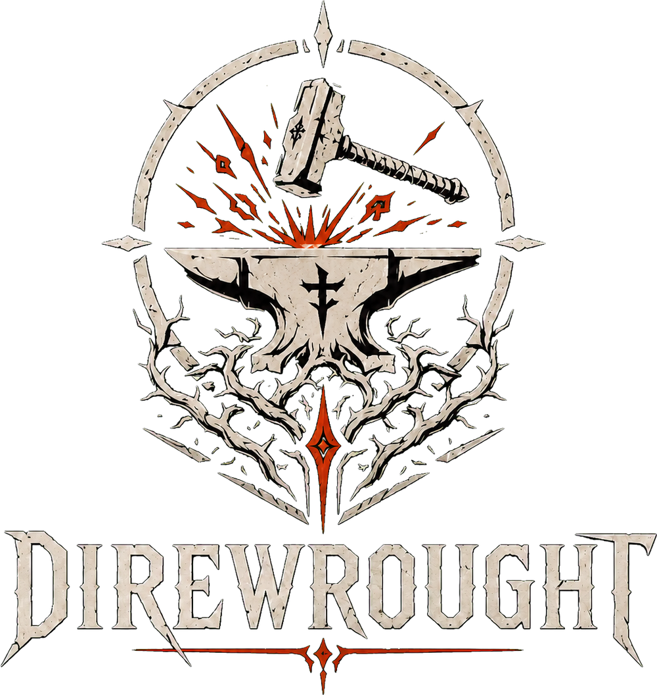
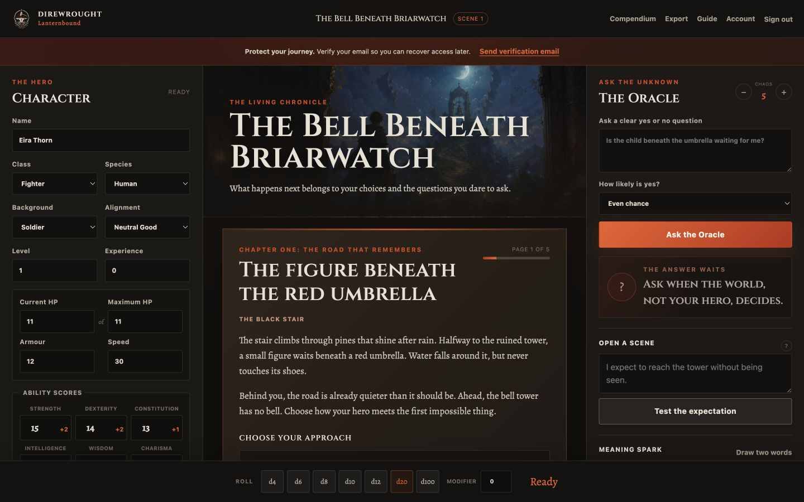
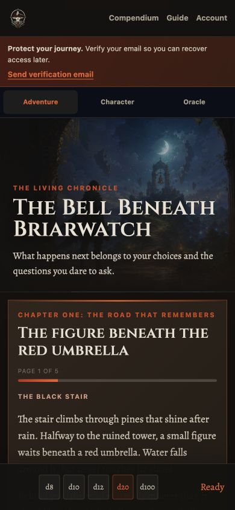
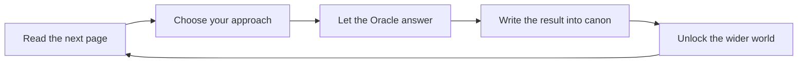
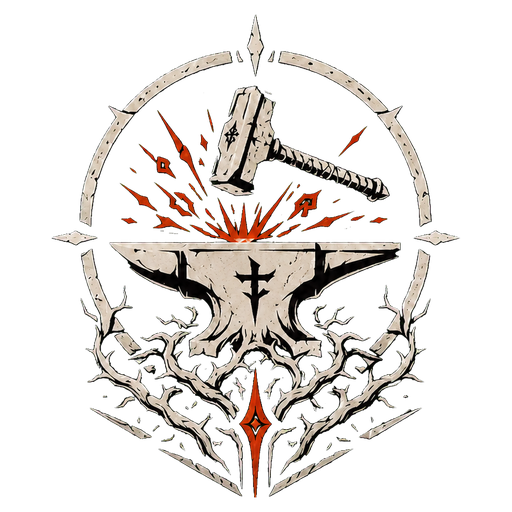

<p align="center">
  <a href="https://direwrought.com/lanternbound/">
    
  </a>
</p>

<h1 align="center">Lanternbound</h1>

<p align="center">
  <strong>A private solo fantasy journey where the book, the Oracle, and your hero write the world together.</strong>
</p>

<p align="center">
  <a href="https://direwrought.com/lanternbound/"></a>
  
  
  
</p>

<p align="center">
  <a href="https://direwrought.com/lanternbound/"><strong>Enter the official journey</strong></a>
  &nbsp; · &nbsp;
  <a href="https://direwrought.com/lanternbound/how-to-play.html">Learn how to play</a>
  &nbsp; · &nbsp;
  <a href="SECURITY.md">Report a security concern</a>
</p>

<br>

<p align="center">
  
</p>

## Your table is waiting

Lanternbound brings the character sheet, living chronicle, Oracle, scene engine, dice, story threads, people met, and a growing fantasy world onto one screen.

There is no paid narrator. There are no advertisements, behavioural analytics, or tracking cookies. Every account receives a private journey beginning with the original Direwrought adventure **The Bell Beneath Briarwatch**.

The guided chapter reads like a dark fantasy novel, but it never decides what your hero must do. Each page establishes a piece of the world, offers meaningful approaches, and asks the Oracle only when the uncertain world must answer. The result becomes permanent canon in your chronicle.

<table>
  <tr>
    <td width="66%"></td>
    <td width="34%"></td>
  </tr>
</table>

## One story, infinite journeys



The first chapter unfolds across five guided pages and fifteen possible approaches.

1. Meet the figure beneath the red umbrella.
2. Recover the name that Briarwatch buried.
3. Open the stone door with no hinge.
4. Descend to the bell dreaming beneath the tower.
5. Awaken the first of the nine Lantern Roads.

Players can follow the offered paths, ignore them completely, ask their own Oracle questions, write independent scenes, or return to the guided chapter later. The authored story provides gravity without turning solo play into a fixed script.

## Everything on the table

| Surface | What it gives the player |
|:---|:---|
| **Story Guide** | Original book style fiction shaped by player choice and Oracle answers |
| **Living Chronicle** | A permanent private record of discoveries, dialogue, actions, and scenes |
| **Character Sheet** | A practical fifth edition compatible hero with abilities, health, class features, and notes |
| **Oracle** | Contextual Yes or No answers, probability, exceptional results, and surprising events |
| **Chaos** | A changing measure of how firmly the hero controls the unfolding situation |
| **Meaning Sparks** | Two word prompts for details the current story has not yet revealed |
| **Threads** | Unresolved goals and mysteries that grow with the adventure |
| **Characters Met** | A persistent cast of allies, strangers, rivals, and impossible beings |
| **Scene Engine** | Expected, altered, and interrupted scene openings |
| **World Remembered** | Lore unlocked one discovery at a time without spoiling what lies ahead |
| **Dice Dock** | Fast cryptographic rolls from d4 through d100 with a modifier |
| **Journey Export** | A private JSON backup that excludes account email and password data |

## The Bell Beneath Briarwatch

Rain silvered the library windows when the abandoned bell above Briarwatch rang once. Its rope was cut twenty years ago. Every candle bent toward the northern hill, and a page appeared in your journal in an unfamiliar hand:

> When the bell speaks again, follow before the road forgets you.

Beyond the black stair wait Orison Vale, the Underbell, a future hand inside your journal, and eight dark roads that once joined a much larger world. Lanternbound will reveal them only when a player reaches them.

## Built for ordinary hosting

Lanternbound is deliberately lean. It runs without a framework, package manager, advertisement service, analytics platform, paid artificial intelligence service, or persistent background worker.

| Layer | Implementation |
|:---|:---|
| Application | PHP 8.2 or newer |
| Production data | MySQL with PDO prepared statements |
| Local development | SQLite with the same application model |
| Interface | Semantic HTML, self hosted CSS, and browser native JavaScript |
| Email | Brevo transactional delivery for confirmation and recovery |
| Hosting target | Standard GoDaddy Deluxe Linux hosting or equivalent |

This public repository is source available for transparency and security review. It does not grant deployment or self hosting permission. Authorised commercial and deployment rights require a separate written agreement.

## Security by design

| Protection | Implementation |
|:---|:---|
| Password storage | Argon2id when available, with the supported PHP default as fallback |
| Database access | Prepared statements with emulation disabled |
| Browser sessions | Strict mode, HttpOnly, SameSite Strict, secure cookies on HTTPS, and idle expiry |
| Request integrity | Server generated CSRF tokens and cross site write rejection |
| Account recovery | Single use expiring tokens stored only as SHA 256 hashes |
| Abuse resistance | Authentication and email request rate limits |
| Browser hardening | Restrictive Content Security Policy, frame denial, permissions restrictions, and no third party scripts |
| Player output | Text insertion without executable markup |
| Account control | Export, email confirmation, password recovery, and permanent deletion |
| Repository safety | Production configuration, databases, logs, exports, and secret files ignored by default |

Please read [SECURITY.md](SECURITY.md) before reporting a vulnerability. Never place private player data or exploit details in a public issue.

## Repository map

```text
assets/                  Direwrought imagery, interface code, and self hosted fonts
database/                Fresh installation schemas and the earlier account upgrade
inc/                     Security bootstrap, accounts, and original guided story engine
account.php              Verification and deletion account API
api.php                  Private journey, Oracle, story, scene, and tracker API
index.php                Authentication and the complete play table
how-to-play.html         Public first session guide
privacy.html             Privacy and essential cookie disclosure
config.example.php       Sanitised authorised deployment reference
LICENSE.md               Proprietary source available licence
LICENSES.md              Mandatory third party licences and attribution
```

## Intellectual property

The original Lanternbound application, interface, artwork, The Bell Beneath Briarwatch, the Lantern Roads setting, story passages, characters, and Direwrought presentation are proprietary. Copyright © 2026 C31 Labs. All rights reserved.

Playing through the official Direwrought website is permitted for personal entertainment. Copying, self hosting, redistribution, mirroring, commercial exploitation, unauthorised adaptation, and artificial intelligence training are prohibited for proprietary material except where applicable law expressly provides otherwise.

This repository also contains separately licensed material that remains governed by its original terms. These include applicable Mythic Game Master Emulator Second Edition material under CC BY NC 4.0, SRD 5.2.1 material under CC BY 4.0, and Cinzel and Alegreya under the SIL Open Font License.

Read the complete [proprietary licence](LICENSE.md), [third party notices](LICENSES.md), and [trademark notice](TRADEMARKS.md) before relying on any permission.

## Acknowledgements

Lanternbound stands on the shoulders of generous tabletop creators and open cultural work.

1. Tana Pigeon and Word Mill Games for Mythic Game Master Emulator Second Edition.
2. Wizards of the Coast LLC for SRD 5.2.1 under Creative Commons Attribution 4.0.
3. Natanael Gama for Cinzel and Juan Pablo del Peral for Alegreya under the SIL Open Font License.
4. Every solo player who kept a table alive with a notebook, dice, and one more question.

No endorsement by the third party creators or publishers is claimed.

## The road ahead

The world is designed to grow without erasing what each player made true.

1. Further Lantern Road chapters and regions.
2. Multiple adventure slots for one account.
3. A deeper searchable open rules compendium.
4. More world memory, character, and thread tools.
5. Improved accessibility and player controlled reading options.
6. Additional safe export and continuity tools.

<br>

<p align="center">
  
</p>

<p align="center">
  <strong>The road remembers every choice.</strong><br>
  <a href="https://direwrought.com/lanternbound/">Begin The Bell Beneath Briarwatch</a>
</p>
